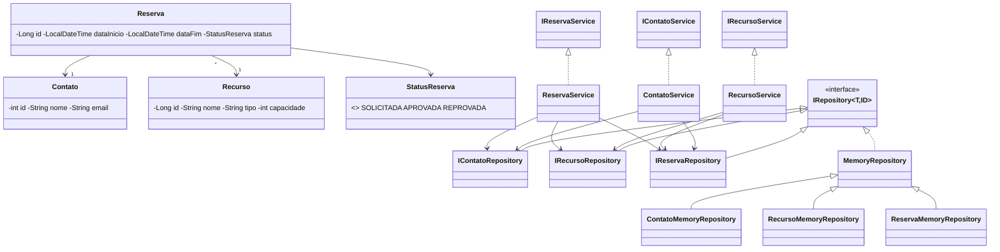

# CRM InPETU hub — Sistema de Reserva de Recursos (MVP)

Projeto da unidade curricular **Programação Orientada a Objetos** (Tecnólogo em ADS, SENAI/SC).
MVP de um CRM para o **InPETU hub** (Sapiens Parque / UFSC) com três cadastros prioritários:

1. **Contatos**
2. **Recursos** (salas de reunião, auditório, equipamentos)
3. **Reservas** de recursos por contatos

Aplicação de console em **Java**, sem bibliotecas externas, com armazenamento **em memória**
(os dados existem enquanto o programa está aberto). Compatível com Java 25: usa só recursos
de linguagem estáveis (compilado e testado com `--release 21`, sem *preview features*).

---

## Como executar

Na pasta que contém `src/`:

```bash
# compilar
mkdir out
javac -encoding UTF-8 -d out $(find src -name '*.java')      # Linux/macOS
# Windows (PowerShell): javac -encoding UTF-8 -d out (Get-ChildItem -Recurse src -Filter *.java).FullName

# menu interativo (apresentação)
java -cp out inpetu.Application

# roteiro de verificação automatizado (sai com código 0 se tudo passar, 1 se algo falhar)
java -cp out inpetu.Application --roteiro
```

No IntelliJ: marcar `src` como *Sources Root* e executar `inpetu.Application`.
Para rodar o roteiro, adicionar `--roteiro` em *Run > Edit Configurations > Program arguments*,
ou escolher a opção **4** do menu.

### Menu

```
1. Contatos      -> Cadastrar | Consultar | Editar | Listar | Excluir
2. Recursos      -> Cadastrar | Consultar | Editar | Listar | Excluir
3. Reservas      -> Cadastrar | Consultar | Editar | Listar | Alterar status | Excluir
4. Executar roteiro de verificação
5. Carregar dados de exemplo
```

Na edição, o campo **Novo ID** existe de propósito: ele permite demonstrar que o sistema
**recusa a alteração de ID**. Datas usam o formato `dd/MM/yyyy HH:mm`.

---

## Regras de negócio implementadas

| Regra | Onde |
|---|---|
| Contato, recurso e reserva têm **ID (PK) único**; cadastrar outro com o mesmo ID é recusado e não sobrescreve o original | `*Service.cadastrar` |
| **O ID não pode ser alterado** na edição (o ID dos modelos é `final` e o serviço recusa dados com ID diferente) | `*Service.editar` |
| Consultar/editar/excluir um registro **inexistente** gera erro claro | `*Service.consultar` |
| Um contato ou recurso **vinculado a uma reserva não pode ser excluído** | `ContatoService.remover`, `RecursoService.remover` |
| A reserva só é feita se o recurso estiver **disponível no período** (sem sobreposição com reservas não reprovadas) | `ReservaService.garantirDisponibilidade` |
| Reserva exige **contato e recurso cadastrados** | `ReservaService.resolverContato/resolverRecurso` |
| Período válido: início e fim obrigatórios e início anterior ao fim | `ReservaService.validarPeriodo` |
| Nova reserva nasce `SOLICITADA`; pode ir para `APROVADA` ou `REPROVADA`. Reserva `REPROVADA` libera o horário | `ReservaService` |
| Campos obrigatórios: nome do contato; nome, tipo e capacidade (>= 1) do recurso | `ContatoService`, `RecursoService` |
| Sem controle de acesso (conforme o MVP) | — |

**Estado estável (critério C3):** todas as validações acontecem *antes* de qualquer gravação.
Se uma operação é recusada, nada é alterado, e o roteiro verifica isso (por exemplo, uma edição
recusada mantém os dados antigos).

**Interpretação de "contato ou recurso repetidos" (reserva):**
- Mesmo **recurso** em período que se sobrepõe a outra reserva ativa -> **recusado** (indisponível).
- Mesmo recurso em períodos diferentes (inclusive logo após o fim da outra reserva) -> permitido.
- Mesmo **contato** reservando recursos diferentes, ou o mesmo recurso em outro horário -> permitido,
  pois a regra do enunciado trata apenas da disponibilidade do recurso.
- Mesmo **ID de reserva** repetido -> recusado (PK duplicada).

---

## Roteiro de verificação (roteiro.verificacao.pdf)

O roteiro do professor foi implementado em a classe interna `RoteiroVerificacao`, em `Application.java`. A saída usa os mesmos
textos do PDF e inclui verificações extras de regras de negócio. Resultado atual: **72 verificações, 0 falhas**.

| Entidade | Item do roteiro | Resultado esperado |
|---|---|---|
| Contato / Recurso | Cadastro: inclusão já existente (mesma PK) | recusado, original preservado |
| Contato / Recurso | Consultar: inexistente | recusado (não encontrado) |
| Contato / Recurso | Editar: alteração de ID | recusado (não permite) |
| Contato / Recurso | Listar: listou todos? | quantidade listada = quantidade cadastrada |
| Reserva | Cadastro: sem contato ou recurso | recusado (dados inválidos) |
| Reserva | Cadastro: contato ou recurso repetidos | recurso ocupado recusado; demais casos conforme interpretação acima |
| Reserva | Consultar: inexistente | recusado (não encontrado) |
| Reserva | Editar: alteração de ID | recusado (não permite) |
| Reserva | Listar: listou todas? | quantidade listada = quantidade cadastrada |
| Extras | Excluir contato/recurso vinculado a reserva | recusado |
| Extras | Editar/cadastrar em horário ocupado | recusado e estado preservado |

---

## Estrutura do projeto

```
README.md
LICENSE
src/inpetu/
├── Application.java          ponto de entrada + classes internas: Sistema, MenuConsole, RoteiroVerificacao
├── model/                    Contato, Recurso, Reserva, StatusReserva
├── repository/               IRepository<T,ID>, IContatoRepository, IRecursoRepository, IReservaRepository
│   └── memory/               MemoryRepository<T,ID> + 3 implementações em memória
└── service/                  IContatoService, IRecursoService, IReservaService + implementações
```

### Diagrama de classes (resumo)



---

## Princípios SOLID aplicados

- **S — Responsabilidade única:** modelos só guardam dados; repositórios só persistem; serviços só aplicam
  regras de negócio; as classes internas `MenuConsole` (entrada e saída) e `RoteiroVerificacao` (testes) ficam separadas dos serviços.
- **O — Aberto/fechado:** novas regras ou novos tipos de armazenamento entram por novas classes/implementações
  das interfaces, sem alterar os serviços. `MemoryRepository` concentra o código comum.
- **L — Substituição de Liskov:** qualquer implementação de `IContatoRepository` (memória, arquivo, banco)
  pode substituir a atual sem quebrar os serviços. 
- **I — Segregação de interfaces:** interfaces pequenas e específicas por entidade
  (`IContatoRepository` tem `buscarPorNome`; `IReservaRepository` tem `buscarPorRecurso` e `buscarPorContato`).
- **D — Inversão de dependência:** serviços e interface de console dependem de **interfaces**, nunca de
  classes concretas. Só a classe interna `Sistema` (em `Application`) conhece as implementações em memória. Trocar por banco de dados
  exige mudar apenas essa classe.

---

## Tratamento de erros

Quando uma regra é violada, o serviço lança `RuntimeException` com uma mensagem clara em português
(ex.: `Já existe um contato com o ID 1.`, `Não é permitido alterar o ID do contato (1 -> 5).`,
`O recurso 'Sala A' não está disponível no período: conflita com a reserva 1.`).

O menu captura o erro e mostra `ERRO: <mensagem>` sem encerrar o programa. Entradas digitadas
incorretamente (letras onde se espera número, data fora do formato) são pedidas novamente.
No roteiro, cada cenário inválido deve ser **recusado**; se for aceito, o item aparece como `FALHOU`.

## Limitações do MVP

- Dados em memória: ao fechar o programa, tudo é perdido (a persistência em banco é a evolução natural).
- Sem controle de acesso (fora do escopo definido).
